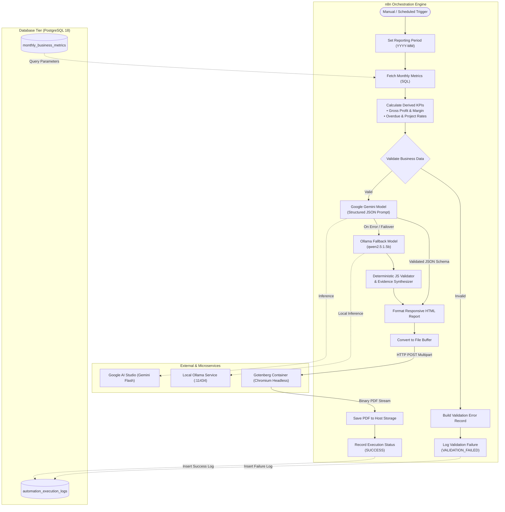

# OmniFlow AI

> **Automated end-to-end business reporting pipeline powered by n8n, PostgreSQL, Google Gemini, Ollama, and Gotenberg.**

---

## 1. Project Overview

**OmniFlow AI** is an intelligent workflow automation system built to transform raw financial and operational data into publication-ready executive management reports.

In traditional corporate environments, compiling monthly business reports requires manual database queries, spreadsheet calculations, drafting commentary, formatting presentations, and exporting PDFs. OmniFlow AI automates this entire lifecycle into a single deterministic, audit-logged workflow.

### Core Objectives
- **Zero-Touch Reporting**: Eliminate repetitive manual report authoring.
- **Data Integrity**: Enforce mathematical validation rules on input metrics before triggering AI synthesis.
- **Resilient Dual-Tier AI**: Cloud inference via Google Gemini with automated fallback to a local Ollama LLM and deterministic validation engine.
- **Production-Grade PDF Generation**: Render HTML/CSS reports into crisp vector PDFs using a headless Chromium service.
- **Complete Lifecycle Auditability**: Maintain full historical traceability for both successful executions and validation failures inside PostgreSQL.

---

## 2. System Architecture



---

## 3. Technology Stack

| Component | Technology | Role |
| :--- | :--- | :--- |
| **Orchestration** | [n8n](https://n8n.io/) | Workflow orchestration, LangChain nodes, and logic branching |
| **Database** | [PostgreSQL 18](https://www.postgresql.org/) | Relational metrics storage and audit execution logging |
| **Generative AI (Primary)** | [Google Gemini](https://ai.google.dev/) (`gemini-1.5-flash` / `gemini-3.8-flash`) | Contextual analysis, risk evaluation, and recommendations |
| **Generative AI (Fallback)** | [Ollama](https://ollama.ai/) (`qwen2.5:1.5b`) | Offline, privacy-first local fallback LLM |
| **Deterministic Validation** | Node.js / JavaScript | Strict metric verification, factual guardrails, and data synthesis |
| **PDF Rendering** | [Gotenberg 8](https://gotenberg.dev/) | Headless Chromium engine converting HTML/CSS into A4 PDF |
| **Containerization**| [Docker & Compose](https://www.docker.com/) | Microservice isolation and host port mapping |
| **Scripting** | PowerShell 7 / Bash | Environment initialization and bootstrap automation |

---

## 4. Key Engineering Features

- **Automated KPI Calculation**: Dynamically computes gross profits, gross profit margin percentages, overdue invoice rates, and project completion ratios directly within workflow expressions.
- **Pre-Execution Validation Gatekeeper**: Enforces strict conditional checks (`revenue > 0`, `overdue <= total`) before consuming LLM API tokens.
- **Zero-Loss Error Auditing**: Records both successful runs (`SUCCESS`) and validation rejections (`VALIDATION_FAILED`) in PostgreSQL with full diagnostic context.
- **Dual-Tier AI Architecture with Offline Fallback**: Features automatic failover from cloud-based Google Gemini to a local Ollama instance (`qwen2.5:1.5b`).
- **Deterministic Evidence-Based Fallback**: An integrated JavaScript validation node enforces that metric figures remain mathematically anchored and prevents LLM hallucinations.
- **Strict Structured Outputs**: Integrates LangChain's Structured Output Parser to force responses into validated, strongly typed JSON objects.
- **Vector PDF Output**: Generates cleanly styled executive PDFs complete with KPI cards, risk analysis callouts, and prioritized action plans.

---

## 5. Database Schema

The system utilizes two primary relational tables:

### `monthly_business_metrics`
Stores monthly raw operational and financial figures for client organizations.
```sql
CREATE TABLE monthly_business_metrics (
    id SERIAL PRIMARY KEY,
    company_name VARCHAR(255) NOT NULL,
    reporting_month VARCHAR(7) NOT NULL, -- e.g. '2026-10'
    currency VARCHAR(10) NOT NULL DEFAULT 'TND',
    total_revenue NUMERIC(15, 2) NOT NULL,
    total_expenses NUMERIC(15, 2) NOT NULL,
    total_invoices INTEGER NOT NULL,
    overdue_invoices INTEGER NOT NULL,
    completed_projects INTEGER NOT NULL,
    active_projects INTEGER NOT NULL,
    created_at TIMESTAMP WITH TIME ZONE DEFAULT CURRENT_TIMESTAMP,
    CONSTRAINT uq_company_month UNIQUE (company_name, reporting_month)
);
```

### `automation_execution_logs`
Records every automated pipeline run for observability and compliance.
```sql
CREATE TABLE automation_execution_logs (
    id SERIAL PRIMARY KEY,
    workflow_name VARCHAR(255) NOT NULL,
    company_name VARCHAR(255),
    reporting_month VARCHAR(7),
    execution_status VARCHAR(50) NOT NULL, -- 'SUCCESS', 'VALIDATION_FAILED'
    report_filename VARCHAR(255),
    error_message TEXT,
    execution_started_at TIMESTAMP WITH TIME ZONE,
    execution_finished_at TIMESTAMP WITH TIME ZONE DEFAULT CURRENT_TIMESTAMP
);
```

---

## 6. Repository Layout

```
omniflow-ai/
├── README.md               # Project documentation and architecture guide
├── LICENSE                 # Project license
├── .gitignore              # Git ignore rules for data, logs, and credentials
├── .env.example            # Environment variables template
├── docker-compose.yml      # Service composition for n8n & Gotenberg
├── database/
│   ├── schema.sql          # PostgreSQL DDL for metrics and logging tables
│   └── sample_data.sql     # Seed data for Northstar Business Services (2026-10)
├── workflows/
│   └── monthly-business-reporting.json  # Sanitized n8n workflow export
├── docs/
│   ├── architecture.md     # In-depth architectural blueprint
│   ├── installation.md     # Step-by-step setup and credential guide
│   ├── workflow-explanation.md # Node-by-node logic and expression reference
│   └── screenshots/        # Visual documentation and previews
├── reports/
│   └── .gitkeep            # Output directory for generated PDF files
└── scripts/
    └── setup.ps1           # Environment validation and setup script
```

---

## 7. Quickstart Guide

### 1. Prerequisites
- [Docker Desktop](https://www.docker.com/products/docker-desktop/) installed and running.
- [PostgreSQL 14+](https://www.postgresql.org/) running locally on port `5432` (or via container).
- A Google Gemini API key from [Google AI Studio](https://aistudio.google.com/).
- (Optional) [Ollama](https://ollama.ai/) running locally on port `11434` with `qwen2.5:1.5b`.

### 2. Environment Setup
```powershell
# Run the automated setup script
.\scripts\setup.ps1

# Or manually copy environment file
cp .env.example .env
```

### 3. Initialize Database
Apply the SQL schema and sample demonstration records:
```powershell
& "C:\Program Files\PostgreSQL\18\bin\psql.exe" -U postgres -d postgres -f database\schema.sql
& "C:\Program Files\PostgreSQL\18\bin\psql.exe" -U postgres -d postgres -f database\sample_data.sql
```

### 4. Start Services
```bash
docker compose up -d
```
Access points:
- **n8n Web Interface**: [http://localhost:5678](http://localhost:5678)
- **Gotenberg API**: [http://localhost:3000](http://localhost:3000)

### 5. Import Workflow
1. Navigate to `http://localhost:5678` in your browser.
2. Select **Workflows** -> **Add Workflow** -> **Import from File**.
3. Select `workflows/monthly-business-reporting.json`.
4. Configure credentials in n8n for:
   - **Postgres** (Host: `host.docker.internal`, Port: `5432`)
   - **Google Gemini(PaLM) Api** (Your Google AI API Key)
   - **Ollama** (Base URL: `http://host.docker.internal:11434`)
5. Click **Execute workflow** to generate the executive report.
6. The resulting PDF is stored in `./reports/Northstar_Management_Report_2026-10.pdf`.

---

## 8. Sample Demonstration Output

The demonstration company is **Northstar Business Services** reporting for period **2026-10** in currency **TND**:
- **Total Revenue**: 125,000.00 TND
- **Total Expenses**: 78,000.00 TND
- **Calculated Gross Profit**: 47,000.00 TND (Gross Margin: 37.60%)
- **Invoice Performance**: 150 Total Invoices, 12 Overdue (Overdue Rate: 8.00%)
- **Project Performance**: 18 Completed, 7 Active (Completion Rate: 72.00%)

The generated PDF report provides an executive summary, segmented KPI metrics, operational observations, data limitations, and three prioritized management actions.

---

## 9. License

This project is licensed under the MIT License - see the [LICENSE](LICENSE) file for details.

Developed by [Rabii Mallek](https://github.com/rabiimallek).
