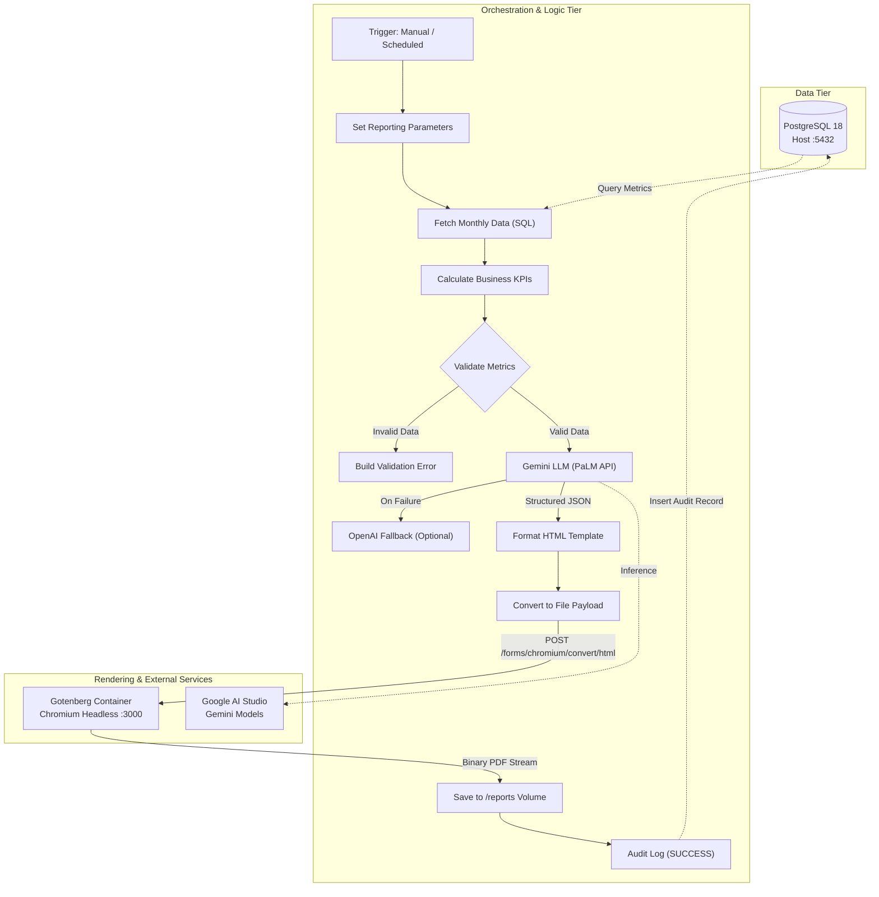

# OmniFlow AI - Technical Architecture

OmniFlow AI is an automated, event-driven reporting pipeline designed to eliminate manual monthly financial and operational report compilation. The architecture combines database extraction, business rule validation, large language model synthesis, headless browser rendering, and persistent execution logging.

---

## 1. System Architecture Overview

---

## 2. Component Details

### A. Data Layer (PostgreSQL)
- **Engine**: PostgreSQL 18 running locally on host port 5432.
- **Role**:
  - Source of truth for business metrics (`monthly_business_metrics`).
  - Persistent repository for execution audit trail (`automation_execution_logs`).
- **Network Path**: Accessed by n8n container via Docker bridge using `host.docker.internal:5432`.

### B. Automation & Orchestration (n8n)
- **Container**: `omniflow-n8n` (`n8nio/n8n:latest`).
- **Role**: Coordinates the entire lifecycle from trigger to file write.
- **Security**: Local bind-mount persistence (`./n8n-data`), sensitive credentials isolated from Git.

### C. Generative Intelligence (Google Gemini)
- **Primary Engine**: LangChain-integrated Google Gemini Chat node within n8n.
- **Parsing**: Paired with a Strict Structured Output Parser enforcing schema conformance for executive summary, financial ratios, operational analysis, risks, recommendations, and analytical limitations.
- **Resilience**: Configured with an onError fallback route to an alternative language model.

### D. PDF Compilation Engine (Gotenberg)
- **Container**: `omniflow-gotenberg` (`gotenberg/gotenberg:8`).
- **Role**: Stateless Chromium-based microservice converting raw HTML/CSS into standardized A4 PDF documents.
- **Interface**: REST API endpoint `/forms/chromium/convert/html` over internal network bridge.

---

## 3. Communication Matrix

| Source Service | Target Service | Protocol / Port | Purpose |
| :--- | :--- | :--- | :--- |
| `n8n` | `PostgreSQL` | TCP / 5432 | Query metrics, write execution logs |
| `n8n` | `Gemini API` | HTTPS / 443 | Send prompt & receive structured JSON |
| `n8n` | `Gotenberg` | HTTP / 3000 | Convert HTML payload into PDF stream |
| `n8n` | Host Disk | Filesystem Mount | Save final PDF to `./reports` (`/reports`) |
