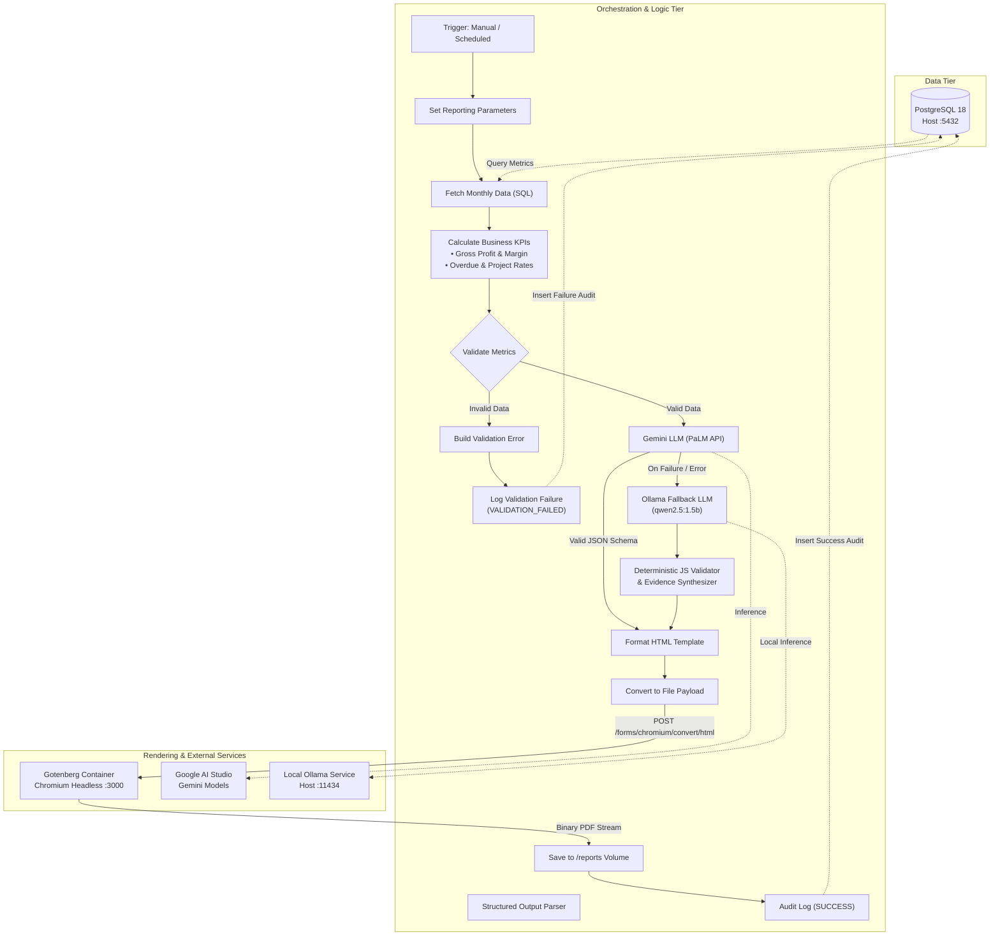

# OmniFlow AI - Technical Architecture

OmniFlow AI is an automated, event-driven reporting pipeline designed to eliminate manual monthly financial and operational report compilation. The architecture combines database extraction, business rule validation, dual-tier generative AI synthesis (cloud and local fallback), deterministic verification, headless browser rendering, and full-lifecycle audit logging.

---

## 1. System Architecture Overview

---

## 2. Component Details

### A. Data Layer (PostgreSQL)
- **Engine**: PostgreSQL 18 running locally on host port 5432.
- **Role**:
  - Source of truth for business metrics (`monthly_business_metrics`).
  - Persistent repository for execution audit trail (`automation_execution_logs`).
- **Audit Logging**: Captures both successful runs (`SUCCESS`) and validation rejections (`VALIDATION_FAILED`).

### B. Automation & Orchestration (n8n)
- **Container**: `omniflow-n8n` (`n8nio/n8n:latest`).
- **Role**: Coordinates the entire lifecycle from trigger to file write.
- **Security**: Local bind-mount persistence (`./n8n-data`), credentials isolated from Git.

### C. Generative Intelligence & Dual Fallback Tier
- **Primary Cloud Engine**: Google Gemini Flash via n8n LangChain integration.
- **Structured Parsing**: Enforces schema conformance for executive summary, financial ratios, operational analysis, risks, recommendations, and analytical limitations.
- **Local Fallback Engine**: If Gemini fails or hits quota limits, execution automatically delegates to a local **Ollama instance (`qwen2.5:1.5b`)**.
- **Deterministic Verification**: Ollama output is received by a dedicated JavaScript validation node that validates facts, re-verifies metrics against input data, and produces an evidence-based executive summary.

### D. PDF Compilation Engine (Gotenberg)
- **Container**: `omniflow-gotenberg` (`gotenberg/gotenberg:8`).
- **Role**: Stateless Chromium-based microservice converting raw HTML/CSS into standardized A4 PDF documents.
- **Interface**: REST API endpoint `/forms/chromium/convert/html` over internal network bridge.

---

## 3. Communication Matrix

| Source Service | Target Service | Protocol / Port | Purpose |
| :--- | :--- | :--- | :--- |
| `n8n` | `PostgreSQL` | TCP / 5432 | Query metrics, write success & failure audit logs |
| `n8n` | `Gemini API` | HTTPS / 443 | Primary AI inference |
| `n8n` | `Ollama` | HTTP / 11434 | Local AI fallback inference via `host.docker.internal` |
| `n8n` | `Gotenberg` | HTTP / 3000 | Convert HTML payload into PDF stream |
| `n8n` | Host Disk | Filesystem Mount | Save final PDF to `./reports` (`/reports`) |
